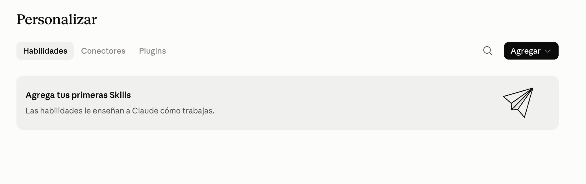
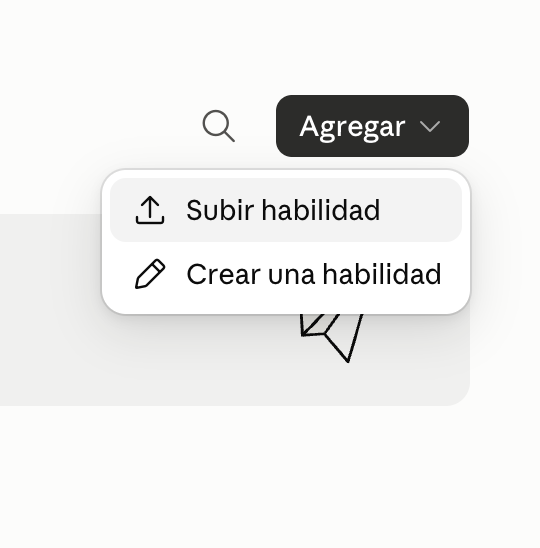
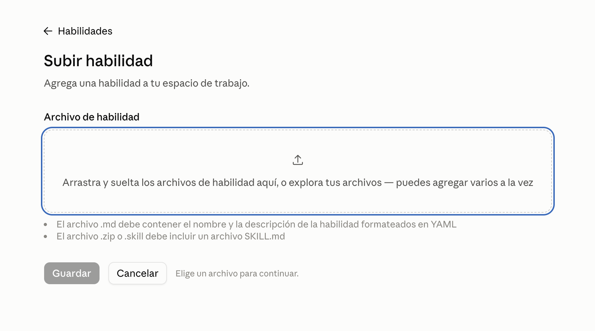
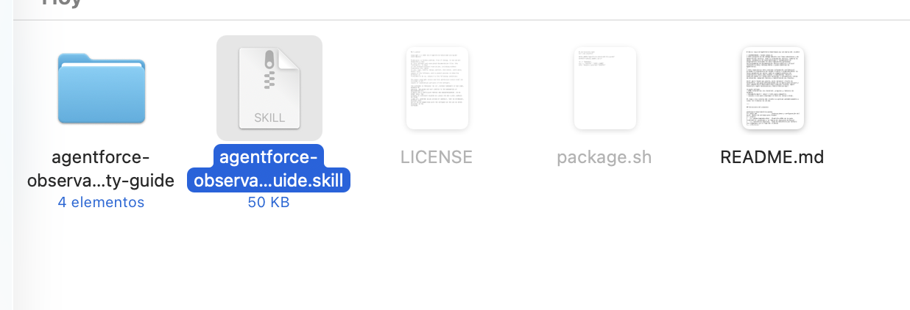
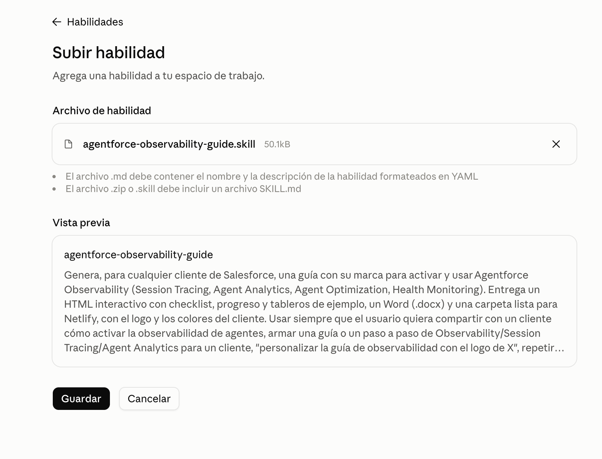
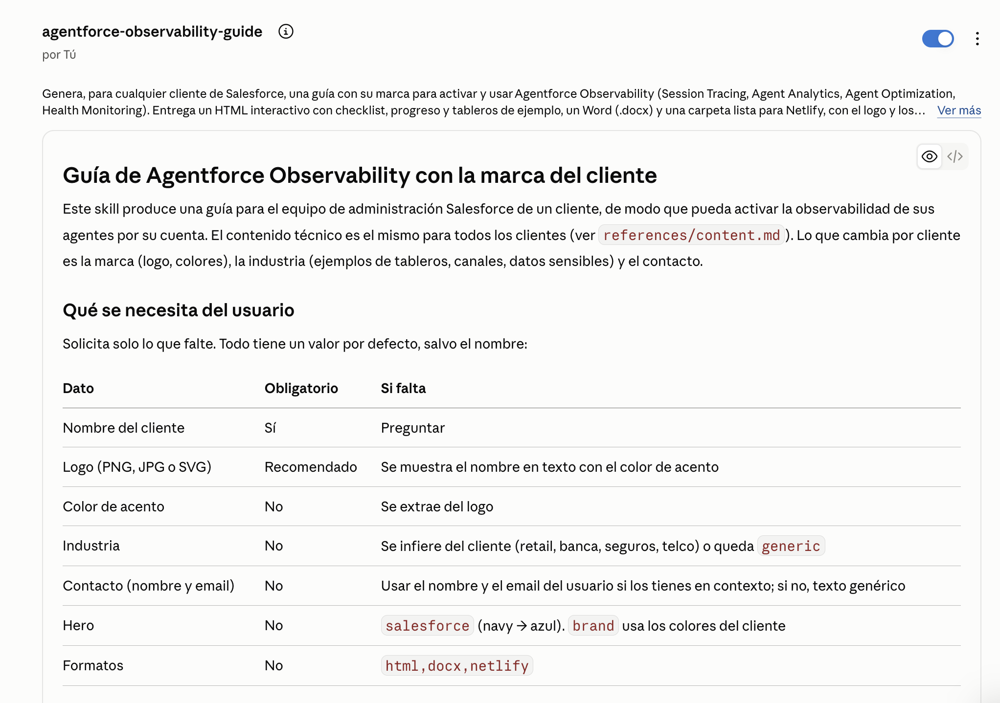
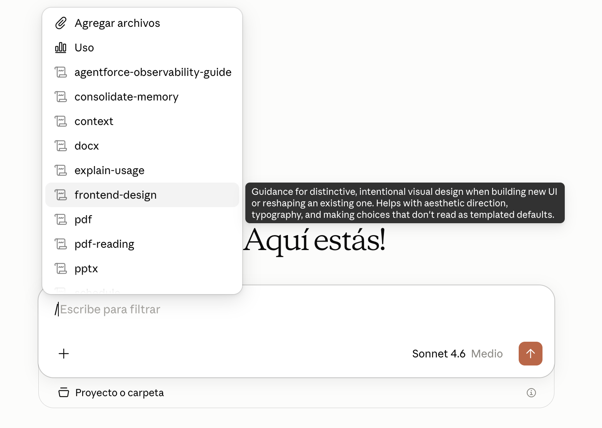
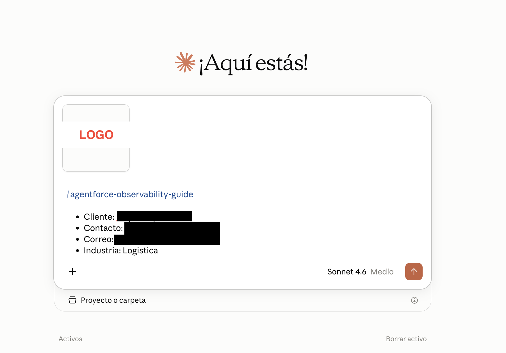

# Skill: Guía de Agentforce Observability con marca del cliente

> **IMPORTANTE / AVISO LEGAL:**
> Este proyecto es de código abierto con fines educativos y de demostración técnica. Toda la información técnica, nombres de menús, parámetros de observabilidad y lineamientos de arquitectura incluidos en este repositorio provienen exclusivamente de documentación técnica pública y oficial (Salesforce Help, Release Notes y guías públicas de Agentforce).
>
> Este repositorio **no contiene información confidencial, privada ni propietaria de ningún cliente u organización**. Su único propósito es servir como un ejemplo práctico de arquitectura sobre cómo diseñar e implementar "Skills" especializados en Claude para optimizar y estandarizar tareas de atención, adopción técnica y habilitación de clientes.

Skill para Claude que genera, para cualquier cliente de Salesforce, una guía personalizada con su marca para activar y usar **Agentforce Observability** (Session Tracing, Agent Analytics, Agent Optimization, Health Monitoring).

La guía incluye:
- HTML interactivo con checklist, progreso y tableros de ejemplo.
- Documento Word (`.docx`) listo para compartir.
- Carpeta lista para desplegar en Netlify (drag & drop).

El logo y los colores del cliente se aplican automáticamente a todos los formatos de salida.

---

## Estructura del proyecto

```
agentforce-observability-guide/
├── SKILL.md                  Instrucciones y configuración del skill (punto de entrada para Claude)
├── assets/
│   ├── guide.template.html   Plantilla HTML de la guía (contiene el contenido y la lógica de inyección de marca)
│   └── salesforce-logo.png   Logo de Salesforce por defecto (se reemplaza con el logo del cliente)
├── references/
│   └── content.md            Referencia técnica: componentes, costos, prerequisitos, activación y fuentes
└── scripts/
    ├── build_guide.py        Script principal: genera HTML, Word y carpeta Netlify
    ├── build_docx.js         Generador del .docx (invocado automáticamente por build_guide.py)
    └── industries.py         Presets de industria: datos ficticios verosímiles para los tableros de ejemplo
```

---

## Requisitos previos

| Herramienta | Versión mínima | Instalación |
|---|---|---|
| Python | 3.10+ | [python.org](https://www.python.org/downloads/) |
| Pillow (Python) | Última | `pip install pillow` |
| Node.js | 18+ | [nodejs.org](https://nodejs.org/) |
| docx (npm global) | Última | `npm install -g docx` |
| LibreOffice (opcional) | Cualquier reciente | [libreoffice.org](https://www.libreoffice.org/) — solo para convertir a PDF |

---

## Empaquetado del skill

Los archivos `.skill` son archivos comprimidos en formato ZIP con una estructura interna específica: la carpeta `agentforce-observability-guide/` debe quedar en la **raíz** del comprimido.

### Generar el archivo `.skill`

**Opción A — script incluido (recomendado):**

```bash
./package.sh
```

**Opción B — comando directo:**

```bash
zip -r agentforce-observability-guide.skill agentforce-observability-guide/
```

Ejecutar desde la **raíz del repositorio**. El ZIP resultante tendrá la carpeta `agentforce-observability-guide/` en la raíz del comprimido, incluyendo de forma recursiva `assets/`, `references/` y `scripts/`.

### Instalar el skill en Claude

1. Abrir **Claude Desktop** (o **Claude Code** / **Coworker**).
2. Ir a *Settings → Skills* (o la sección de skills de tu interfaz).
3. Hacer clic en **Cargar skill** y seleccionar `agentforce-observability-guide.skill`.
4. Una vez cargado, Claude reconocerá automáticamente las instrucciones de `SKILL.md`.

---

## Guía paso a paso: Instalación y Uso

**Paso 1: Acceder al menú de habilidades**
Dirígete a la sección de "Personalizar" en tu entorno de Claude, selecciona la pestaña "Habilidades" y haz clic en el botón "Agregar".



**Paso 2: Seleccionar la opción de subida**
En el menú desplegable, elige la opción "Subir habilidad".



**Paso 3: Cargar el archivo del skill**
Aparecerá una ventana para cargar el archivo. Puedes arrastrarlo o explorar en tus carpetas.



**Paso 4: Seleccionar el archivo empaquetado**
Busca en tu computadora el archivo `agentforce-observability-guide.skill` que generaste previamente y selecciónalo.



**Paso 5: Confirmar la instalación**
Claude mostrará una vista previa con el nombre y la descripción del skill. Verifica que los datos sean correctos y haz clic en "Guardar".



**Paso 6: Verificación del skill activo**
El skill ya estará instalado y visible en tu lista de habilidades, listo para ser utilizado.



**Paso 7: Invocar el skill en el chat**
Para usarlo, abre un nuevo chat y escribe la barra diagonal `/`. Se desplegará el menú de habilidades; selecciona `agentforce-observability-guide`.



**Paso 8: Invocar el skill con los parámetros requeridos**
Con el skill ya seleccionado (`/agentforce-observability-guide`), adjunta el archivo de imagen con el logotipo de tu cliente. En la misma caja de texto, detalla los parámetros de generación en forma de lista o texto plano (Cliente, Contacto, Correo e Industria). Esto evitará que Claude tenga que hacerte preguntas adicionales y generará la guía en un solo paso.



---

## Prueba de ejecución local

Para verificar que el entorno está correctamente configurado y ver todas las opciones disponibles:

```bash
python3 agentforce-observability-guide/scripts/build_guide.py --help
```

Ejemplo de generación completa:

```bash
python3 agentforce-observability-guide/scripts/build_guide.py \
  --client "Acme Corp" \
  --logo /ruta/al/logo.png \
  --industry retail \
  --contact-name "María García" \
  --contact-email maria@salesforce.com \
  --out ./salida
```

El script imprime un JSON con el color de acento elegido y las rutas de los archivos generados.

---

## Industrias disponibles

El skill incluye presets con datos ficticios pero verosímiles para:

- `retail` — Retail / supermercados
- `banca` — Banca y servicios financieros
- `seguros` — Seguros
- `telco` — Telecomunicaciones
- `generic` — Genérico (por defecto si no se especifica industria)

Para agregar una industria, copiar un bloque en `scripts/industries.py` y agregar sinónimos en `ALIASES`.

---

## Notas sobre contenido técnico

El contenido de referencia (`references/content.md`) tiene fecha de última verificación. Los datos de costo, los nombres de menús y los permisos cambian con cada release de Salesforce. Se recomienda verificar las Release Notes si han pasado más de tres meses desde esa fecha.

**Regla general de costos (octubre 2026):** la observabilidad estándar no consume créditos de Data 360. Sí consumen los dashboards nuevos desde cero, las fuentes externas y los objetos semánticos nuevos. Las acciones del agente siguen consumiendo Flex Credits.

---

## Licencia

Este proyecto se distribuye bajo la licencia **MIT** (Open Source). Consulta el archivo [LICENSE](LICENSE) para más detalles.
